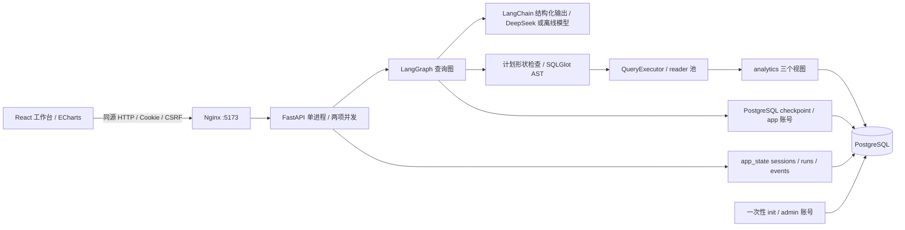
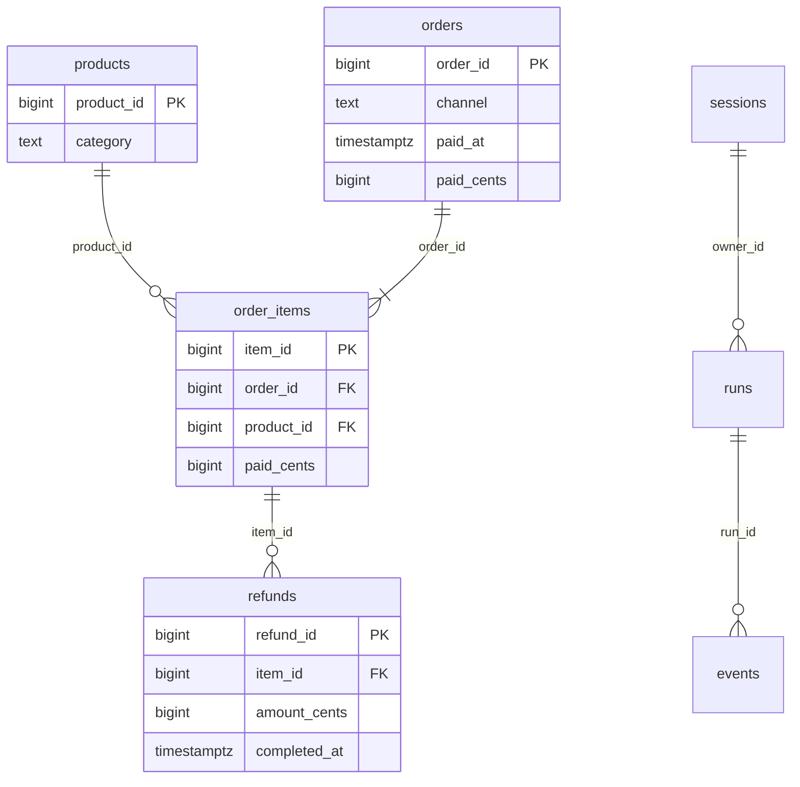

# 架构与请求走读

## 运行结构

模型只接收问题、补充说明、固定参考日期、批准视图字段和指标字典。没有数据库连接工具；标准答案、原始业务表和管理员凭据不进入模型输入。运行镜像只复制 `backend/app` 和 `data/metrics.yaml`，评测与手算数据在独立初始化/检查镜像中。

LangChain 提供消息、供应商适配和 Pydantic 结构化输出契约；LangGraph 提供状态、条件边、interrupt 和 checkpoint。业务口径、SQL 校验、执行限制、会话归属、确定性报告和独立评分由项目实现。`learning_demo.py` 中的 `create_agent` 是学习样例，生产查数流程使用显式查询图。

## 数据关系

业务表三条外键由数据库约束；`runs.owner_id` 引用 `sessions.owner_id`，`events.run_id` 引用 runs。应用另外在每次读取/继续时检查 owner 归属。checkpoint 用服务端 `shoplens:<run_id>`，只由 app 账号写入。会话 Cookie 原值仅在浏览器，数据库保存其哈希；删除 Cookie 后不提供跨会话找回。

| 分析视图 | 一行代表什么 | 时间与金额 |
|---|---|---|
| sales_lines | 已支付订单的一条商品明细 | paid_at / paid_cents |
| refund_events | 一次成功退款 | completed_at / amount_cents |
| cash_events | 一次收款或成功退款事件 | occurred_at / 有正负号的 amount_cents |

直接把多明细订单与多次退款连接会放大金额。当前查询只读单个分析视图，禁止模型 JOIN；需要关联指标时应先分别聚合。五指标的定义、维度、单位和零分母规则以 [metrics.yaml](../data/metrics.yaml) 为准。

## 一次请求如何返回结果

以“2026年9月各渠道实付金额”为例：

1. `frontend/src/api.ts` 取得 `/api/session` 的会话与 CSRF token。`POST /api/runs` 只提交问题；请求不能指定 owner 或 thread。
2. `workspace.py:create_run → Workspace.start` 检查 Cookie、Origin、CSRF 和并发名额，生成 run_id，写入 app_state，返回 HTTP 202。
3. 后台 `Workspace.work → QueryService.initial_state → graph.stream`。`plan` 用 LangChain 返回 QueryPlan：paid_amount、channel、2026-09-01 至 2026-10-01。
4. 若口径含糊，`waiting → clarify` 中断，浏览器显示补充框；带 revision 的原子 UPDATE 领取补充后 `Command(resume=...)` 恢复，重复提交返回 409。
5. `context → draft` 加载指标字典并生成候选 SQL。`validate` 对照确认的计划检查聚合、分组、排序与日期，再经 SQLGlot 检查真实数据源、函数和语句类型。
6. `QueryExecutor.execute` 用 analytics_reader，只读事务、3 秒语句超时、200 行上限，读取 `analytics.sales_lines`。9 月区间是上海时间 `[2026-09-01T00:00:00+08:00, 2026-10-01T00:00:00+08:00)`，金额仍是整数分。
7. `summarize → build_report` 从查询结果确定性生成表格、金额展示与条形图数据；不让模型补造数值或因果解释。失败可修复一次，否则留下明确失败。
8. 每次图状态写入 checkpoint 和 runs/events；前端每 650ms 轮询 GET run，表格与 ECharts 使用同一 report。刷新或点击历史重新读取持久结果，不重新调用模型。

对应源码：[workspace](../backend/app/workspace.py)、[query_graph](../backend/app/query_graph.py)、[query_plan](../backend/app/query_plan.py)、[query_executor](../backend/app/query_executor.py)。

## 范围与限制

- 五指标；日、渠道、类别；显式 Top N；最多两个期间比较。比较不能同时使用日分组或 Top N，单期间最多 366 天。
- 主流程只接受限定 SQL 形状，合法的其他写法也会拒绝。执行器不是通用 SQL 沙箱，AST 通过也不代表业务口径正确。
- 默认最多一次 SQL 修复、五次模型调用、两轮澄清；90 秒节点活动预算在节点边界检查。等待补充不计入活动预算；补充 24 小时到期。
- 单 API 进程、两项并发；不支持多副本或 durable job queue。服务重启后运行中的请求标中断，重试创建新 run，不能声称恰好执行一次。
- 本地 Cookie 会话并非用户登录和多租户系统；历史最多 50 条。无真实数据接入、预测、库存、广告归因或自动写数据库。
- 模型质量、容器启动、公网可用是三个独立结论。真实评测失败与限制见 [报告](../evals/REPORT.md)；当前容器仅监听本机，未部署公网。
