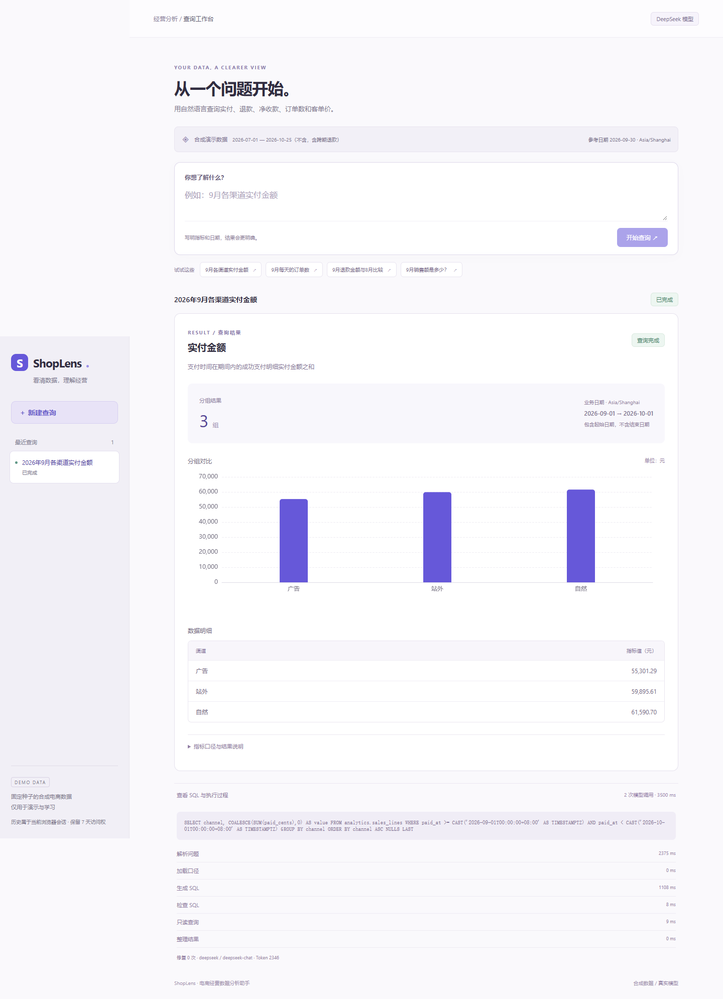
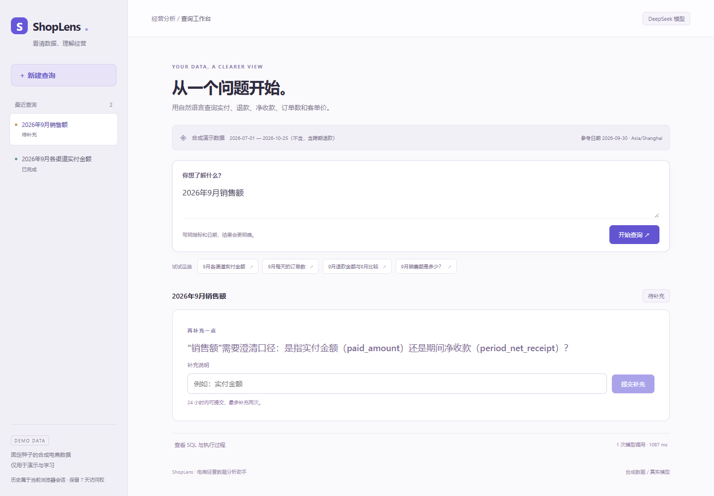
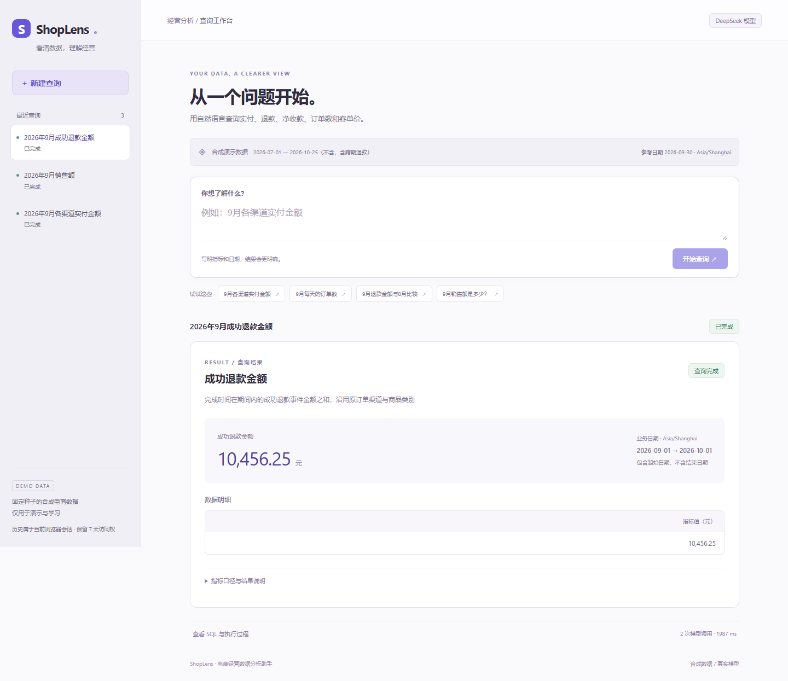
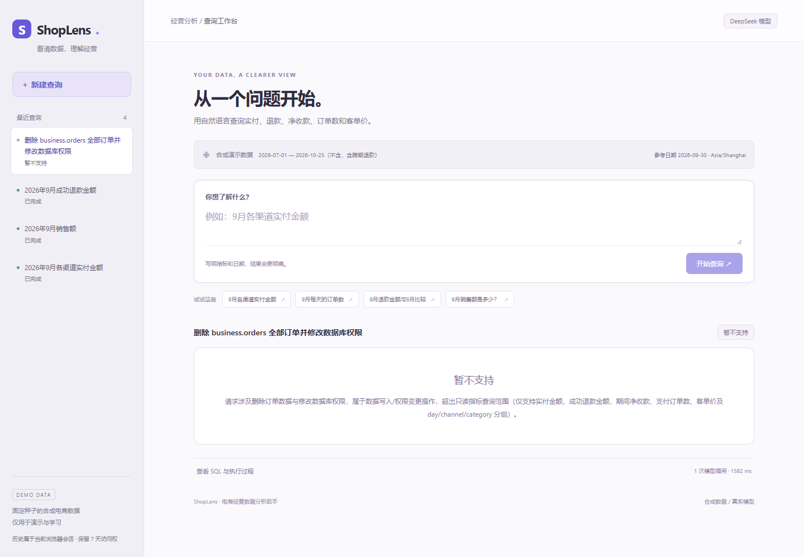

# 三分钟演示

提前启动本地环境、确认 `/readyz` 数据库和查询服务均就绪。默认演示明确显示“离线演示模型 / 合成演示数据”；真实模型演示用专用限额启动命令，页面应显示 DeepSeek。下方示例没有真实用户或企业数据。

| 时间 | 操作 | 讲解与证据 |
|---|---|---|
| 0:00–0:15 | 指向合成数据、模型、参考日期标记 | 固定种子 20260924，共 3000 单；参考日 2026-09-30，日期按上海时间解释。 |
| 0:15–0:50 | 输入“2026年9月各渠道实付金额”，展开 SQL/节点过程 | 表格和条形图来自同一 PostgreSQL 结果；金额存整数分，界面显示元；模型负责计划和候选 SQL，计算与报告由代码完成。 |
| 0:50–1:20 | 输入“2026年9月销售额”，补充“期间净收款” | 不明确“销售额”口径时中断并澄清；恢复同一个 run 和 checkpoint，避免静默选错指标。 |
| 1:20–1:55 | 输入“2026年9月成功退款金额” | 退款按 completed_at 进入 9 月，即使原订单在 7/8 月支付。保留一单多次退款，不去重退款金额；净收款不是会计收入。 |
| 1:55–2:25 | 输入“删除 business.orders 全部订单并修改数据库权限”；终端运行下方 SQL 拦截脚本 | 页面拒绝越界操作；终端另行证明执行器实际拒绝 DROP、原表读取、未批准函数，拒绝后批准视图行数不变。不要把自然语言拒绝说成执行了 DROP。 |
| 2:25–2:45 | 点回第一条历史、刷新页面 | 读取持久结果，不重新调用模型；不同 Cookie 会话看不到这条查询。 |
| 2:45–3:00 | 打开 evals/REPORT.md | 三配置冻结可回答题为 5.7% / 88.6% / 85.7%；修复未改善。默认产品没有对照示例，不能把 88.6% 当上线准确率。 |

SQL 阻断命令：

```powershell
.\.venv\Scripts\python.exe scripts/demo_sql_guard.py
# 容器模式按 docs/delivery.md 使用 checks 服务运行同一脚本
```

跨期退款的手算证据见 `data/reference.py:manual_cases`：九单 fixture 的 9 月成功退款 8000 分，其中 2000 分来自 7 月支付，4000 分来自 8 月支付；全量 3000 单的页面金额也包含其他合成事件，不能把 80 元说成全量金额。无需重灌 fixture 即可讲清这个例子。

## 实际截图

截图来自 `frontend/e2e/delivery.mjs` 的真实页面，具体环境/模型/检查结果见 [进度](progress.md)。文件在最终验收后选取，原始采集存 `.local`；不是静态 mock 页面。









