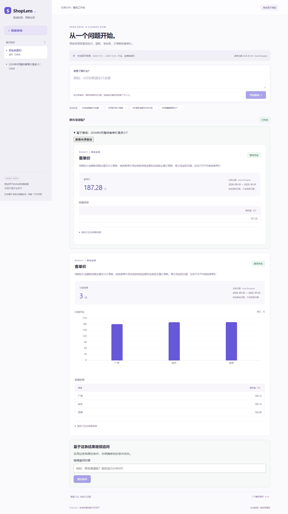

# 基于成功结果继续追问（2026-10-27）

## 设计与边界

用户已选择结果下的明确入口，并授权自主处理实现细节。主输入框仍创建独立查询。
采用服务端保存的规范化计划作为基础，解析本次文字为结构化条件变更，再合并并验证完整计划。
未选用拼接原问题与新问题（条件冲突不可靠），也不增加自动关联最近查询或任意聊天。

新增 `POST /api/runs/{id}/followup`，请求只有 question。复用 Cookie、CSRF、owner 校验；
来源必须 succeeded 且含合法 ready 计划。来源计划由服务端 snapshot 取得，客户端不得传入计划或权限。
新 run 的 snapshot/checkpoint 保存来源 ID、问题及基础计划；公开接口只返回来源 ID/问题。
使用现有 JSONB 持久化，无数据库结构迁移；旧记录没有来源即独立查询。
重试从原追问文字和保存的基础计划重新开始；澄清仍恢复同一 checkpoint。

五指标、日期、day/channel/category、比较与 Top N 沿用现有边界。结构化变更中空值表示继承，
清除比较/排名有显式字段，整体分组使用空列表。明确变更优先，歧义或不支持的改变不得静默继承。
合并后必须经 QueryPlan、原计划/SQL 校验、AST 安全检查和 reader 只读执行。
页面显示直接来源及其结果，允许回看；原记录不被覆盖，历史标明追问关联。

## 实现前登记的验收场景

| 编号 | 输入/操作 | 预期 |
|---|---|---|
| F01 | 2026年9月整体客单价 → 那各渠道呢？ | 继承客单价和9月，仅 channel 分组；独立原始数据核对 |
| F02 | F01结果 → 改成2026年8月 | 保留指标/分组，期间改为 [08-01,09-01) |
| F03 | 成功结果 → 那销售额呢？ → 期间净收款 | 先澄清口径，保留日期；补充后完成 |
| F04 | 浏览器追问、刷新、回看原问题 | 原记录/结果保留；新记录来源与结果恢复 |
| F05 | 另一会话引用来源 | 404，不能读取计划或创建追问；缺CSRF拒绝 |
| F06 | 主输入框单独“那各渠道呢？” | 不继承，仍独立解析 |
| F07 | 未成功/不存在来源、伪造计划/owner | 409/404/422，不执行模型/SQL |
| F08 | 追问澄清后进程重启、过期重试/失败重试 | 来源与基础条件保留；新重试记录不覆盖原记录 |
| F09 | 五指标、按日/类别/整体、显式换指标/日期 | 明确变更覆盖，其他条件继承 |
| F10 | 比较/Top N变更、取消；不支持过滤/预测；无效日期 | 支持的计划受原限制；其余澄清/拒绝而非静默忽略 |
| F11 | 模型返回额外权限字段/错误SQL | 协议/计划/SQL检查阻断，修复仍最多一次 |

离线测试使用固定模型和真实 PostgreSQL，不能充当真实模型质量。
真实模型只跑预登记的 F01、F02、F03 小样本，预算沿用 .local/eval-budget-20261008.json，
开始为790/800；原问题一次2调用，F01/F02各2，F03澄清1+恢复2，预计9调用，最多剩余额度10。
真实请求只含合成问题/补充、基础计划、字典、批准schema及必要SQL/稳定错误，不含参考答案/订单/数据库凭据。
旧冻结题已曝光，只作标记后的回归，不能称盲测。旧Docker镜像独立保留，不作为新源码验证。

## 使用与复现

打开 http://127.0.0.1:5173，先新建 `2026年9月整体客单价是多少？`。
在成功结果下的“继续追问内容”填写 `那各渠道呢？` 并提交，再追问 `改成2026年8月`。
新结果上方显示直接来源及原结果；“查看来源查询”用于回看。历史中的“追问”标记、URL和关联都存库。
追问 `那销售额呢？` 会要求明确口径，补充 `期间净收款` 后保留原日期继续执行。

```powershell
$env:PYTHONUTF8='1'
$env:PATH='D:\Project_02\.local\tooling\node_modules\.bin;'+$env:PATH
.\scripts\pg.ps1 start
.\.venv\Scripts\python.exe scripts/verify.py --frozen-used-for-iteration --npm D:\Project_02\.local\tooling\node_modules\.bin\npm.cmd
# 定向场景默认离线模型，但使用真实PostgreSQL；out必须是全新目录
.\.venv\Scripts\python.exe scripts/check_followups.py --out evals/runs/my-followups-offline
```

运行统一浏览器验收前须停止容器web释放5173；测试自行启动本机API。
显式 `--real-model` 的定向脚本复用原预算，并在不足9次余额时明确NOT_RUN；现在只剩1次，不能原样重跑真实序列。

## 实测结果（2026-10-27）

- 最终统一验收退出0：**PASS=10 / FAIL=0 / NOT_RUN=2**；137离线＋21真实PG＝158项pytest通过。
  构建、80组Python/SQL与14手算参考核对、标记后的离线评测和两项真实Edge浏览器回归通过。
  两项NOT_RUN是默认未启用的通用真实能力/图冒烟；未使用 `--skip-postgres`。
- 新增追问测试30项（27离线、3真实PG）；覆盖F01–F11及空patch、冲突条件、无效日期/排名澄清、异常释放并发槽位、读库失败后来源保留与重试。
  真实PG接口测试独立按原始合成记录核对渠道客单价；内存测试不替代权限/时区验证。
- `check_followups.py --out evals/runs/20261027-followups-offline` 与 `...-offline-final`：均6/6、0 API。
- `check_followups.py --real-model --out evals/runs/20261027-followups-real`：**6/6、9 API、11655已知Token、0修复**；
  四个成功结果按原始记录评分，另覆盖歧义暂停和原结果保留。模型输入不含参考答案/原始订单。
  审阅后另查既有真实记录：4/4没有额外比较、Top N或额外结果表，新增调用0；原结果文件未覆盖。
- 预算由790变为**799/800**；940158已知Token＋22236历史未知预留＝962394/2000000，在途0，剩余1调用。
  未重置账本或增加上限，未核实费用单价。
- 独立只读审阅发现3类Important，已加失败测试后修复：首次读库异常不释放槽位、取消比较被误判为新增比较、离线解析静默忽略未知条件。
  还增强了失败状态保存，保证首次读库失败后也能保留来源并重试；评分器补查额外比较/排名/表数量。

### 验证过程中保留的失败与版本限制

首次新增离线测试12失败/4通过；页面实现前新增浏览器测试因缺追问输入超时。
首次真实PG尝试因本机实例/沙箱连接返回503；之后并发启动的测试争用单进程锁。改为宿主启动实例并顺序运行后通过。
第一次独立评分错误使用 `local()` 默认中午，导致与业务午夜边界不一致；修正评分侧为00:00，未改产品口径/数据。
浏览器测试曾直接检查旧完成状态而早于新URL，修正为先等待新run URL。
中间一轮统一验收PASS=9/FAIL=1（第二会话页面定位超时）；直接完整浏览器复跑2/2，关闭前一用例上下文后最终统一验收通过。
初次Prettier命令误用tooling目录（只有npm），改用frontend/node_modules/.bin后完成格式化。

真实模型运行在最终审阅防御性修复之前；manifest记录运行时未提交源码摘要，HEAD仍为基线3c323910。
之后仅修离线解析、worker异常/状态保存及评分，真实模型提示词/patch合并/SQL规则未再改；最终源码重新通过离线、真实PG和浏览器。
余额不足重跑完整9调用序列，因此不声称最终提交再次经过真实模型验证。
本次不是盲测、完整80题真实回归、真实模型浏览器测试或长期负载测试。
离线有限表达不支持的要求会明确澄清/拒绝；没有扩大到单渠道过滤、任意聊天、预测或因果。

## 新容器交付

在源码验收后仅执行 `compose -p shoplens-stage6 ... build api web` 和 `up -d --no-deps --wait --wait-timeout 60 api web`。
新api/web均healthy，原db继续healthy，init创建时间未变且保持Exited(0)。未运行init、未重灌、未删除卷。
替换前后原12条历史的ID/问题/状态摘要完全一致，三个视图行数为5641/684/6325且不变。
新镜像真实Edge页面冒烟5/5：离线provider、新追问关联、刷新/来源结果、原结果不变、跨会话404。
5173目前运行本次新镜像，仍是离线模型＋真实容器PostgreSQL，可直接操作新功能。

证据：`docs/evidence/followups-verify.txt`、`followups-container-browser.json`、`followups-container-preservation.json`；
真实/离线定向原始记录位于上述evals/runs目录，源码摘要和预算在manifest/summary中。
截图已检查不含Key/Cookie，见下图。图表大于500kB的既有chunk提示保留，构建成功。


