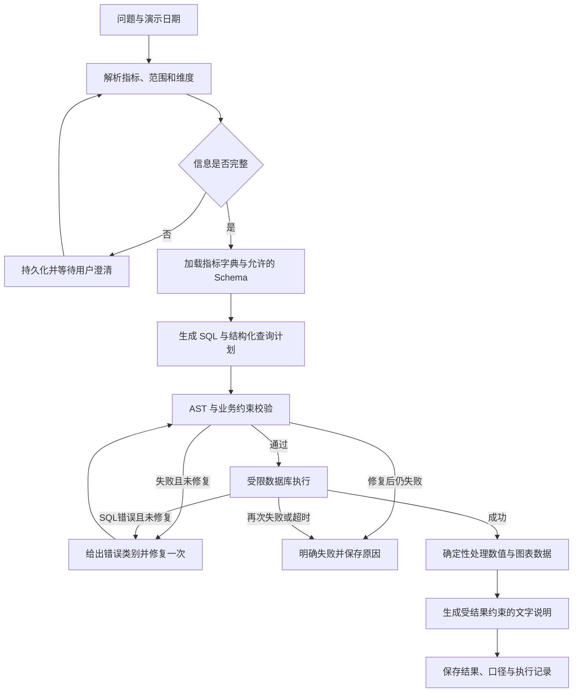

# ShopLens 项目计划

日期：2026-09-24。名称为工作名，可后续修改。

## 1. 决策与定位

做一个电商经营数据分析助手，服务于需要快速查数的模拟运营人员。首版只面对一个固定 PostgreSQL 演示数据集。

用户可提出：“2026 年 8 月各渠道的实付金额是多少？”“9 月期间净收款比 8 月减少了多少，哪些渠道贡献了主要差额？”

系统解释口径、必要时追问、生成并校验 SQL、执行查询、展示图表与数据依据。渠道差额属于描述性分解，不能据此断言广告、产品质量等因果关系。

作品集分工：

| 维度 | MockMate 文档已描述 | ShopLens 重点补充 |
|---|---|---|
| 核心对象 | 简历、回答、题目和知识片段 | 订单、商品、订单明细、退款事件 |
| 编排方式 | 自研循环；真人模式另有固定流程 | LangChain 组件 + LangGraph 显式流程 |
| 正确性 | 检索命中、评分依据和行为约束 | 指标口径、SQL 结果、分组与时间边界 |
| 存储 | 新版真人会话主要保存在内存 | 数据库业务数据、查询历史、图状态持久化 |
| 面试重点 | 工具调用循环与失败恢复 | 关系型数据、语义约束、数据库权限、可复现评测 |

对 MockMate 的判断来自 README、web-frontend、deployment 和 live-rag-evaluation 文档阅读，没有重新运行或审计实现。旧演示与新版真人模式的能力不能混写。

## 2. 首版边界

必做：

- 单个固定数据库、四张业务表、预先定义的分析视图。
- 实付金额、成功退款金额、期间净收款、支付订单数、客单价五种指标。
- 按日、渠道、商品类别分组；明确日期范围、比较两个期间、Top N。
- 信息不足时追问；用户澄清后继续同一任务。
- 可见 SQL、结果表格、口径卡片、柱状图或折线图。
- 校验失败或 SQL 执行报错时最多修复一次；失败明确结束。
- 查询记录与状态持久化；刷新可查，重启后可查看已完成任务，并恢复等待澄清的任务。
- 固定评测数据、对照基线、失败案例与真实测试记录。

不纳入首版：任意数据库连接、任意文件导入、自动找数据源、多租户权限平台、任意 Python 执行、预测/因果分析、自动发邮件、微调、多智能体、MCP Server。后续扩展必须有实际用途和时间余量。

## 3. 数据与指标规范

### 数据集

使用自行生成、固定随机种子的合成电商数据，并在界面和 README 明确标注。时间范围建议 2026-07-01 至 2026-09-30，约 3,000 个订单、数十个商品。数据量只是演示规模，不作为性能成果。

四张表：

- products：商品 ID、名称、类别。
- orders：订单 ID、渠道、创建时间、支付时间、支付状态、实付总额（整数分）。一个订单首版仅一次成功支付。
- order_items：明细 ID、订单 ID、商品 ID、数量、已分摊优惠后的明细实付金额（整数分）。
- refunds：退款 ID、订单明细 ID、退款金额（整数分）、完成时间、状态。允许同一明细分多次退款。

数据约束：明细实付金额之和等于订单实付总额；成功退款累计不超过明细实付金额；未支付订单不进入实付统计；未完成退款不进入退款统计。仅使用 CNY；首版排除税费、运费及汇兑。

必须包含人工可复算的小型 fixture：一单多商品且跨类别、同一明细多次退款、跨月退款、支付后全额退款、取消但未支付、零成交日、月末时间边界、不同订单金额相同。随机数据不能代替这些边界样例。

### 指标字典

| 指标 | 固定定义 |
|---|---|
| 实付金额 | paid_at 落在期间内的成功支付订单/明细实付金额之和 |
| 成功退款金额 | completed_at 落在期间内且状态成功的退款金额之和 |
| 期间净收款 | 同期实付金额减同期成功退款金额；不命名为会计收入 |
| 支付订单数 | paid_at 落在期间内的成功支付订单 ID 去重计数 |
| 客单价 | 同期实付金额 / 同期支付订单数；分母为 0 返回空值并说明 |

按商品类别分组时，支付订单数定义为“购买该类别的支付订单 ID 去重数”，类别客单价为“该类别明细实付金额 / 该类别支付订单数”。一单跨类别会在多个类别分别计数，类别订单数不能相加得到总订单数；总体客单价必须用总金额除总去重订单数，不能平均类别客单价。该定义写入指标 YAML、口径卡和独立参考计算。

退款按退款实际完成时间计入当期，渠道和商品类别沿用原订单/商品归属。这意味着本期退款可以来自上期订单；必须在口径卡说明。按支付订单归属的净额属于另一个指标，首版不混用。

使用 Asia/Shanghai 解释业务时间，数据库使用带时区时间；日期范围统一为左闭右开。演示“今天/上周”使用固定演示参考日期，并在页面展示，不能悄悄使用机器当前时间。

“销售额”等歧义词需要澄清指实付还是期间净收款；未指定期间时先追问。百分比变化的基期为 0 时返回“不可计算”，不能显示无穷大。

### 分析视图与关联规则

建立 analytics.sales_lines（每行一个已支付明细）、analytics.refund_events（每行一个成功退款事件），必要时增加 analytics.cash_events（统一为有正负金额的收退款事件）。视图提供正确粒度、日期、渠道、类别和金额。

模型只能查询明确公开给它的分析视图。若需要跨视图关联，必须先在相同维度聚合，再关联；禁止直接把订单、明细、多次退款展开后 SUM 订单金额。SUM(DISTINCT amount) 不能作为去重补丁。

指标 YAML 记录定义、单位、时间字段、允许维度、视图、关联关系和示例。首版直接按指标加载小型字典与少量人工核验示例，不强制引入向量库。后续有足够语料和对照证据再增加语义检索；不要把字典查找描述成已验证的 RAG 优化。

## 4. 技术方案

| 层次 | 选型与用途 |
|---|---|
| 后端 | Python 3.12 + FastAPI + Pydantic；接口和严格结构化结果 |
| 模型与工具 | LangChain 当前维护版本的模型适配、消息、工具和结构化输出组件 |
| 编排 | LangGraph StateGraph，显式节点、条件边、暂停与恢复 |
| 数据库 | PostgreSQL；业务数据与应用状态逻辑隔离；SQLAlchemy + Alembic 管理应用数据 |
| SQL 校验 | SQLGlot 按 PostgreSQL 方言解析 AST，结合允许列表与数据库权限 |
| 前端 | React + TypeScript + Vite；ECharts 仅两类固定图表 |
| 持久化 | 应用 runs/events/sessions 表；LangGraph PostgreSQL checkpointer |
| 验证与交付 | pytest、少量关键 Playwright 流程、Docker Compose、依赖锁文件 |

实现前核对当前官方文档、运行最小兼容性检查并锁定版本，不把本文件当具体包版本的依据。主模型优先使用已熟悉的国内服务商；DeepSeek 的 LangChain 集成可作为默认候选。模型 ID 来自实际可用配置，先验证工具调用和结构化输出，再冻结评测配置。

先实现一个真实服务商和一个离线假模型，不做复杂供应商路由。没有 Key 时可以完成离线开发，但真实模型指标必须保持“未验证”。不要求购买 GPU 或订阅追踪平台。

流程：

图状态包含：owner_id、run_id、用户问题、澄清结果、规范化指标和时间范围、SQL、校验结果、执行结果引用、repair_count、状态。模型不能改 owner_id、访问权限、修复次数上限等服务端字段。

LangChain 用于模型、工具和输出协议；LangGraph 控制必要步骤。不要为了出现框架名字把一套 create_agent 自由循环再套进每个图节点。可独立写一个最小 create_agent 学习样例，用于理解其与自定义图的差异，不计入核心成果。

### 执行与失败边界

- SQL 解析后只允许受支持的单条只读查询；检查 CTE、子查询、函数和表引用，无法确认时拒绝。
- 禁止写入、DDL、COPY、CALL、系统表、未经允许的函数、跨库/外部访问；不能只检查 SELECT 开头，也不能依赖 LLM 自检。
- SQL 查询使用独立 analytics_reader 凭据，只可读指定分析视图；不能写应用状态、不能获得初始化数据库权限。
- 状态存储使用单独应用凭据。数据库启动和迁移使用的较高权限不得用于执行模型 SQL。
- 每次查询只读事务，默认 statement_timeout 3 秒，输出上限 200 行，限制笛卡尔积和不受支持的高开销构造。分页/行数限制不能替代超时。
- 执行器通过最多读取上限加一行等方式判断截断，返回 truncated。区分用户明确要求的 Top N 与执行器保护上限；截断时提示缩小范围或改为聚合，不能从部分结果计算完整总额、占比、变化率或声称完整排名。
- 只读权限并不自动限制所有函数副作用或资源消耗；AST 允许列表与数据库权限共同生效。
- 错误修复全流程最多一次；网络重试单独限次，总任务有时间和模型调用预算，错误分类可见。
- 图表使用类型化数据配置，前端不执行模型生成的 JavaScript；数字和变化率由 SQL/代码计算。
- 执行记录展示节点、SQL、结果依据、时间与错误类别，不要求模型输出内部思维链。

以上是本项目的查询执行约束，不应宣称形成通用 SQL 沙箱。

### 会话和任务

匿名会话通过安全随机服务端标识关联所有权，Cookie 采用 HttpOnly 等基础设置。所有读取/继续接口在服务端校验任务归属；不可依赖“任务 ID 难猜”。仅演示一个商家数据集，不宣称多租户数据隔离。

接口至少包括：创建查询、读取状态/结果、提交澄清、列出当前会话历史。首版用短轮询读取状态，SSE 不是必做。

首版单服务进程、有限并发，不引入 Redis/Celery。任务元数据和 checkpoint 存库：已完成结果可跨重启读取，等待澄清的图可恢复；启动时将没有活跃执行者的运行任务标为 interrupted，明确显示可重试，不宣称自动精确续跑或 exactly-once。澄清步骤之前避免不可重放副作用。

## 5. 评测与验收

### 数据集与对照

建议 80 条功能问题：40 条开发集、40 条冻结测试集。另有至少 20 条非法查询/边界测试。按问题模板族隔离开发集和冻结集，避免仅换措辞造成泄露。

每条记录包含：问题、固定参考日期、所需澄清、预期指标/范围/分组、预期结果或独立计算方法、比较方式。标准 SQL/答案只供评测使用，不进入模型上下文、示例库或检索库。

先由开发者人工核验小型 fixture；再由独立确定性脚本基于原始数据计算答案，避免待测 SQL 同时充当唯一标准答案。金额精确到分；浮点比率约定容差；无排序问题比较规范化结果集合，有排序/Top N 问题验证顺序和并列规则。

对比三种配置，保持数据快照、模型配置和 SQL 执行约束一致：

1. 基线：问题 + 可用 Schema，一次生成，无业务示例。
2. 加入指标字典及人工核验示例，一次生成。
3. 加入同样字典及示例，并允许一次错误修复。

不预设增强方案一定更好。首次开发可以只跑开发集；冻结集在方案稳定后统一运行。调整方案后必须记录版本，不能挑选最好的一次充当总体结果。

### 指标

- 查询结果正确率：可回答问题中数值、维度、过滤与时间范围全部正确的比例。
- SQL 执行成功率：单列，不能当作回答正确率。
- 澄清/拒绝行为：应澄清或拒绝的样例是否正确处理，以及可回答问题被错误拒绝的比例。
- 一次修复成功率：首次失败的可修复问题中，修复后结果正确的比例。
- 执行约束：固定非法输入是否全部被阻断；不外推为现实攻击阻断率。
- 延迟与成本：成功率同时报告；记录每题模型调用数、Token、端到端耗时；样本少时注明分位数不稳定。费用使用运行时价格配置估算，缺失时只报 Token。

上线前关键验收：

1. 多商品+多次退款不重复计数；跨期退款口径正确；同金额订单不被错误去重；跨类别订单数与类别客单价符合字典。
2. 模型给出写操作或禁止的函数/表访问时，无法进入执行。
3. 信息不足会暂停，补充后恢复；修复上限确实生效。
4. 页面展示的数据、SQL、图表和历史结果一致；说明中的数字有结果依据；截断结果被标注且不用于全量统计。
5. 两个浏览器会话无法互读/继续对方查询；刷新不丢已完成记录；重启状态诚实。
6. 至少一次真实模型冒烟，覆盖正常查询、澄清、跨期退款和失败；未获得 Key 或网络不可用时记录为阻塞项。
7. Compose 从干净环境启动并完成验收后才能标注容器可用。公网部署是可选扩展，未执行不写已上线。

不预先承诺“准确率 95%”。若冻结集正确率不足，分类分析并缩小支持范围；不能隐藏错误或修改测试答案来提高指标。

## 6. 四周核心 + 两周缓冲

| 周 | 工作与交付 | 你要学会的内容 | 参考投入 |
|---|---|---|---|
| 第1周 | 指标定义、四表数据、边界 fixture、参考查询、受限 SQL 执行器 | JOIN、GROUP BY、CTE、去重、时间范围、数据库角色 | 14–18小时 |
| 第2周 | LangChain 模型接口、LangGraph 图、澄清、一次修复，CLI 跑通 | 消息/工具/结构化输出、State/Node/Edge、错误分类 | 14–18小时 |
| 第3周 | FastAPI、数据库状态、前端表格图表、checkpoint、历史与恢复 | 任务状态、Cookie归属校验、持久化和幂等 | 14–18小时 |
| 第4周 | 固定评测、基线比较、关键浏览器测试、Compose、演示与README | 结果评测、失败分析、日志排查、可复现交付 | 14–18小时 |
| 第5–6周 | 修复真实模型问题、盲测案例、简历和面试训练；时间充足再部署 | 根据证据优化、说明取舍和限制 | 20–30小时 |

预估约 76–102 小时，包含学习和验收。若 SQL 需要从头补，第5–6周作为基础和返工缓冲，不增加功能。

每日建议：30分钟理解一个概念，60–90分钟实现/验证，30分钟复盘和手工修改。AI 写完代码不能替代你完成最后两项。

若工期紧：先删公网部署、导出、美化、SSE和扩展检索，保留数据口径、只读执行、最小图流程、结果评测。暂停恢复可在第5周完成，但此前要明确标为未完成，不能用假持久化验收通过。

## 7. 最终交付证据

- 可运行仓库、锁定依赖、.env.example、迁移与固定数据种子。
- 3分钟演示：正常查数→歧义澄清→跨期退款→被阻止的非法请求→执行记录。
- 架构图、指标字典、数据库关系图、5个代表性失败案例。
- 可复现的开发/冻结评测集、基线和改进的原始运行结果。
- 一份“实际实现 / 尚未验证 / 范围限制”说明。
- 简历条目只填实测样本数、结果、延迟和个人贡献；保留开源参考来源。

## 8. 选型参考

检索日期为 2026-09-24；实现时再次核对当前接口并锁定版本。

- [LangChain overview](https://docs.langchain.com/oss/python/langchain/overview)：模型、工具、Agent 抽象与 LangGraph 的关系。
- [LangGraph overview](https://docs.langchain.com/oss/python/langgraph/overview)：状态编排、持久化、人工介入。
- [官方 SQL Agent 教程](https://docs.langchain.com/oss/python/langgraph/sql-agent)：用图组织 SQL 查询步骤；本方案进一步限定业务范围和执行权限。
- [ChatDeepSeek 集成](https://docs.langchain.com/oss/python/integrations/chat/deepseek)：候选模型适配器。
- [SQLGlot 文档](https://sqlglot.com/sqlglot.html)：SQL 解析与 AST；解析器本身不等于执行沙箱。
